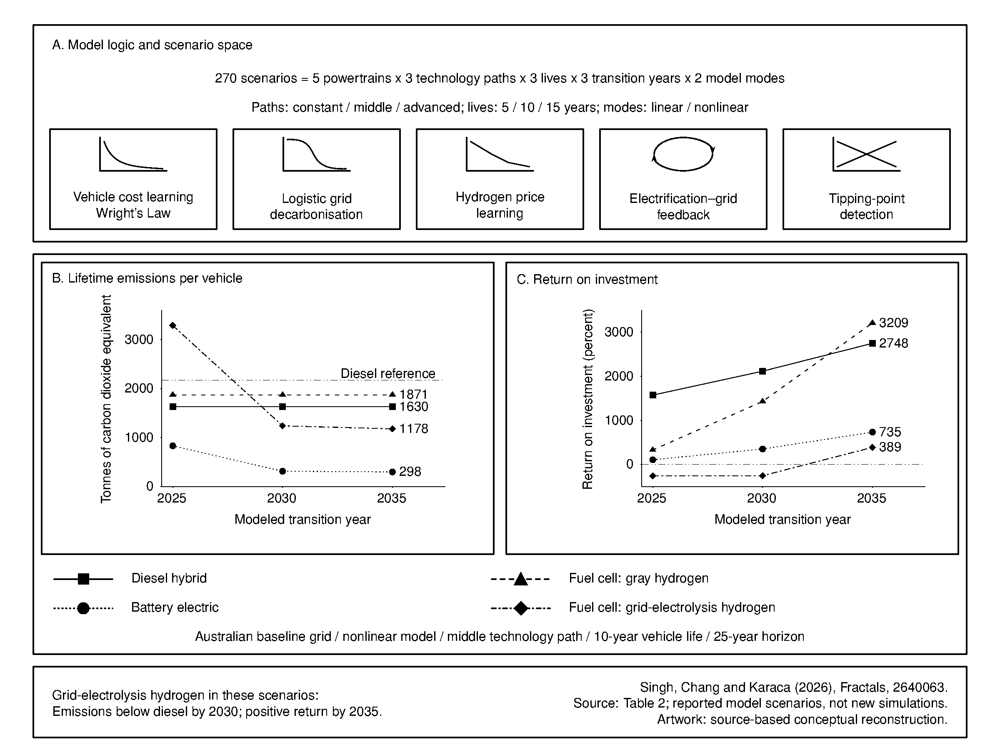

# Decarbon: pathways for Australian heavy-freight decarbonisation

How do vehicle technology, energy supply and transition timing affect the cost
and emissions of Australian heavy freight? The published study compares these
choices using a techno-economic simulation with nonlinear learning and energy
transition effects.

[](figures/abstracts/assets/decarbon.svg)

Conceptual graphical abstract of the published study.
[Editable figure and scientific source notes](figures/abstracts/README.md).

## Publication

**Techno-Economic Pathways Modeling and Nonlinear Optimized SEEA-ROI
Longitudinal Dynamic Simulation for Decarbonizing Australian Heavy
Transportation Systems**

Gaurav Singh, Elizabeth Chang and Yeliz Karaca. *Fractals*, article 2640063
(25 pages), published 20 May 2026.
[Read the publication](https://doi.org/10.1142/S0218348X26400633).

Singh and Chang: School of Science, Technology and Engineering, University of
the Sunshine Coast, Australia. Karaca: Department of Mathematics and Department
of Neurology, University of Massachusetts, USA, as listed in the publication.

Manuscript PDFs and draft editions are not distributed in this repository.

### Published abstract

Techno-economic analysis resting on nonlinear systems theory provides a robust framework
for decarbonizing commercial and public fleets. Standard linear models fail to capture
the feedback loops, threshold effects and phase transitions inherent in freight
electrification, minor perturbations may cascade into system-wide regime shifts.
Accordingly, this study embeds five nonlinear mechanisms: Wright’s Law cost learning,
logistic grid decarbonization, experience-curve hydrogen price decline, an
electrification–grid feedback loop and tipping-point detection, within a techno-economic
and optimized simulation for Australian heavy long-haul freight, which accounts for
approximately 22% of transport emissions. The model provides three principal outputs,
which are the identification of a sequencing problem for green hydrogen deployment,
quantification of a persistent emissions–economics inversion across the scenario space
and provision of a time-indexed decision framework that maps transition year, Heavy
Fleet choice, technology scenario to ROI and cumulative emissions, which aims at serving
as a quantitative procurement guide for operator capital planning across the 2025–2035
time period. In addition, the model evaluates cumulative lifecycle emissions, total cost
of ownership and return on investment relative to diesel across 270 scenarios over a
25-year horizon, using SEEA-aligned Australian emission factors, NREL ATB 2024 vehicle
costs and DCCEEW grid projections. Under nonlinear dynamics with Mid technology
assumptions and a 10-year operating lifetime from 2025, battery-electric vehicles
deliver emissions approximately 62% below diesel (ROI +108% nonlinear versus +96%
linear) with Wright’s Law reducing the cost premium by AUD 33k; fuel-cell vehicles on
gray hydrogen achieve ROI +329% nonlinear with emissions 14% below diesel; and diesel
hybrid recovers its capital premium within the first operating year. Fuel-cell vehicles
on green hydrogen amplify emissions to 49% above diesel under a 2025 transition, a
sequencing problem resolving later than linear projections suggest. Sensitivity analysis
confirms diesel price, electricity price and annual utilization as dominant economic
sensitivities, while the emissions–economics inversion is robust across all tested
ranges. Tipping-point analysis identifies crossover years, providing a critical
decision-support tool for fleet transitions aligned with Net Zero 2050. The novelty of
this paper lies in the integration of the nonlinear SEEA-aligned Australian emission
factors with fleet transition ROI analysis across multiple technology learning pathways
and transition timing scenarios, which is an integration and model scheme which has been
established and implemented in the Australian heavy freight context from longitudinal
dynamic dimensions.

```bibtex
@article{singh2026technoeconomic,
  title = {Techno-Economic Pathways Modeling and Nonlinear Optimized SEEA-ROI Longitudinal Dynamic Simulation for Decarbonizing Australian Heavy Transportation Systems},
  author = {Singh, Gaurav and Chang, Elizabeth and Karaca, Yeliz},
  journal = {Fractals},
  year = {2026},
  pages = {2640063},
  doi = {10.1142/S0218348X26400633}
}
```

## Research and available code

The paper combines SEEA-aligned emissions accounting, total cost of ownership
and return on investment. It reports 270 scenarios over a 25-year horizon and
considers cost learning, grid decarbonisation, hydrogen prices, electrification
feedback and tipping points. Its reported results depend on those assumptions
and transition dates; this repository does not claim to reproduce them.

The available `digital_twin` package and two notebooks are an **exploratory
synthetic-data demonstration**, separate from that published simulation. They
compare illustrative diesel, battery-electric, fuel-cell and hybrid vehicles.
The package provides energy-at-wheel, exponential battery degradation, discounted
NPV/TCO, break-even and parameter-sampling helpers. The notebooks contain their
own illustrative assumptions and calculations. Parameters are not calibrated
operating measurements or the publication's complete input set.
The notebooks run sequential source files in `examples/`; their code has been
reorganized without changing the numerical calculations. Notebook outputs are
cleared, and the full notebook analyses have not been rerun for this release.

`monte_carlo_simulation` in the package samples parameter dictionaries; it does
not evaluate a fleet model. The second notebook separately computes illustrative
NPV distributions and portfolio comparisons. Package helper tests check numerical
contracts; they do not establish investment suitability or paper reproducibility.

## Use the code

Python 3.10 or newer:

```sh
python3 -m venv .venv
source .venv/bin/activate
python -m pip install -e .
python -m unittest discover -s tests
```

```python
from digital_twin.models import calculate_energy_consumption, calculate_npv

energy_joules = calculate_energy_consumption(
    mass=18000, grade=0, distance=100000, velocity=22.2,
)
npv_aud = calculate_npv(150000, [30000] * 5, discount_rate=0.08)
```

See [contributing.md](contributing.md) for notebook setup and maintainer workflow.
The [research-ops audit](docs/audit.md) records known uncertainty-handling,
zero-baseline and executable-documentation issues in the exploratory helpers.

## Data

Government inputs remain at the official
[Australian Energy Statistics 2024 release](https://www.energy.gov.au/publications/australian-energy-update-2024)
and [machine-readable download](https://www.energy.gov.au/publications/australian-energy-statistics-2024-machine-readable-files).
Credit: DCCEEW, Commonwealth of Australia, Australian Energy Statistics 2024.
The release provides historical statistics through 2022–23. Consult the original
tables for coverage, units, missing values and attribution conditions.

The demo uses illustrative values in its code and does not consume these tables.
No government-data mirror or paper-specific dataset is hosted on HF for this
companion. Future original research outputs can be released there when available.

## Attribution and rights

The published paper retains its stated authorship and publisher terms. The
recovered demo identifies its authors as “Digital Twin Team”; that attribution
is retained. No additional reuse license is assigned to the code in this release.
The government data has its own [CC BY 4.0 terms](https://www.energy.gov.au/copyright).
